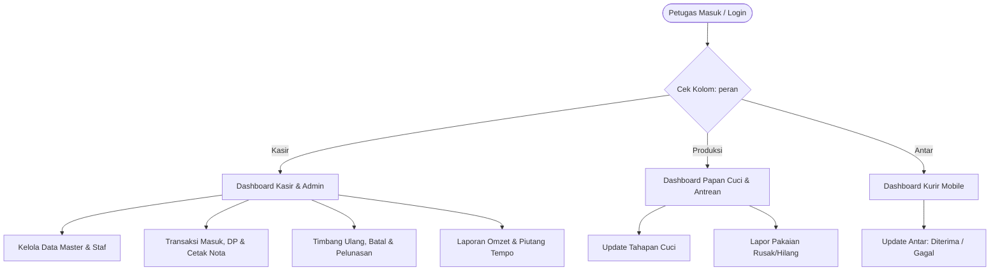
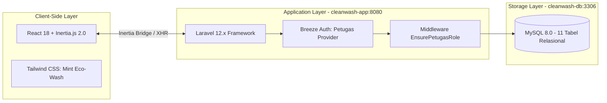
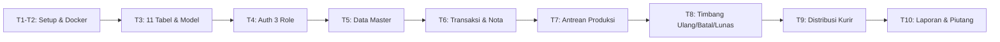

# Product Requirements Document (PRD)
# Sistem Informasi Manajemen Laundry - CleanWash

---

## 1. Ringkasan Eksekutif & Informasi Dokumen

| Atribut | Informasi |
| :--- | :--- |
| **Nama Produk** | **CleanWash** - Smart Laundry Management System |
| **Versi Dokumen** | `1.1.0 (Final Aligned Specification)` |
| **Tanggal Pembaruan** | 22 November 2026 |
| **Target Pengguna** | Bisnis Laundry Kiloan & Satuan Modern (Skala UMKM hingga Menengah) |
| **Status Proyek** | Fase Implementasi Aktif (Progress: ±55% - Tahap 5 Selesai) |
| **Tech Stack** | Laravel 12, React (Inertia.js 2.0), Tailwind CSS, MySQL 8.0, Docker |

CleanWash adalah aplikasi web operasional terpadu yang dirancang khusus untuk mendigitalkan seluruh siklus bisnis jasa binatu (laundry). Sistem ini mengintegrasikan loket kasir, antrean fisik lantai produksi cuci/setrika, hingga manajemen pengantaran kurir berbasis perangkat bergerak (*mobile*), dengan penekanan pada transparansi tagihan, pencegahan kehilangan/kerusakan pakaian, dan pengendalian piutang pelanggan.

---

## 2. Latar Belakang & Pernyataan Masalah (*Problem Statement*)

### 2.1. Masalah Operasional Laundry Tradisional
1. **Risiko Tertukarnya & Kerusakan Pakaian:** Kurangnya pencatatan rincian fisik pakaian saat penerimaan dan tidak adanya dokumentasi terpusat saat insiden robek/luntur terjadi di lantai produksi.
2. **Kekacauan Alur Produksi:** Layanan khusus (seperti cuci sepatu, bed cover, atau dry clean) memiliki urutan penanganan berbeda dari cuci reguler, namun sering dipukul rata sehingga menurunkan kualitas dan efisiensi waktu.
3. **Kebocoran Finansial & Piutang Macet:** Pelanggan sering mengambil pakaian tanpa pelunasan yang tercatat tertib (*bayar nanti/tempo*), serta kesulitan melacak sisa uang muka (DP) dan potongan diskon promosi.
4. **Disorganisasi Distribusi Kurir:** Kurir antar-jemput sering kali gagal mengantarkan cucian karena pelanggan tidak di tempat, tanpa adanya sistem penjadwalan ulang (*re-schedule*) yang terstruktur.

### 2.2. Nilai Solusi (*Value Proposition*) CleanWash
* **Kontrol Akses Terisolasi (3 Peran Internal):** Alur kerja spesifik untuk **Kasir**, **Staf Produksi**, dan **Petugas Antar**.
* **Fleksibilitas Tahapan Produksi Dinamis:** Setiap jenis layanan dapat memiliki alur tahapan pencucian unik berbasis data JSON.
* **Akuntabilitas Keuangan Ketat:** Penguncian harga saat transaksi (*price snapshot*), proteksi saklar `hak_bayar_belakangan`, dan integrasi kompensasi kerusakan pakaian yang otomatis memotong tagihan akhir.
* **Responsif Multi-Device:** Antarmuka desktop/tablet nyaman untuk Kasir dan Produksi, serta tata letak ramping yang dioptimalkan untuk ponsel pintar kurir di lapangan.

---

## 3. Matriks Pengguna & Peran (*User Personas & RBAC*)

Sistem CleanWash mengadopsi model **Single Auth Guard Internal** (`petugas`), di mana pelanggan umum **tidak memiliki portal login**. Seluruh interaksi pelanggan dijembatani oleh staf melalui nota cetak/PDF dan layanan komunikasi langsung.

### Rincian Peran:
1. **Kasir (Merangkap Administrator):**
   * **Tanggung Jawab:** Penerimaan pelanggan, input rincian cucian, penerimaan uang kas (DP/Lunas/Tempo), pembatalan/penyesuaian timbangan, penjadwalan kloter kurir, dan pemantauan laporan harian.
   * **Perangkat Utama:** PC Desktop / Laptop / Tablet Meja Kasir.
2. **Staf Produksi:**
   * **Tanggung Jawab:** Memproses cucian fisik di mesin cuci, pengering, dan meja setrika; memperbarui status tahapan pengerjaan; serta mendokumentasikan insiden pakaian rusak/luntur/hilang beserta nilai kompensasi.
   * **Perangkat Utama:** Tablet gantung / Monitor lantai kerja produksi.
3. **Petugas Antar (Kurir):**
   * **Tanggung Jawab:** Mengambil pakaian yang siap didistribusikan, melakukan perjalanan antar ke alamat pelanggan, menandai konfirmasi penerimaan, atau mencatat alasan gagal antar dan tanggal kirim ulang.
   * **Perangkat Utama:** Smartphone Android / iOS (Mobile View).

---

## 4. Arsitektur Sistem & Spesifikasi Teknologi

* **Backend:** PHP 8.3 + Laravel 12.x (Arsitektur MVC, Form Requests, Resource Controllers, dan Eloquent ORM).
* **Frontend:** React 18 dengan Inertia.js 2.0 (SPA tanpa komplikasi pembuatan REST API manual), menggunakan Tailwind CSS 3.4.
* **Basis Data:** MySQL 8.0 dengan nama kolom berbahasa Indonesia terstandarisasi (`snake_case`) sesuai `SKEMA_DATABASE_CLEANWASH.md`.
* **Kompilasi Aset:** Vite 6.x dengan Hot Module Replacement (HMR) terisolasi pada port host `5175`.
* **Lingkungan Deploy:** Docker Compose multi-kontainer (`cleanwash-app`, `cleanwash-vite`, `cleanwash-db`).

---

## 5. Logika Bisnis Inti & Model Matematis (*Core Business Rules*)

### 5.1. Formula Perhitungan Sisa Tagihan (*Balance Calculation*)
Sisa tagihan yang harus dibayar pelanggan dihitung secara otomatis oleh sistem dengan rumus deterministik:

$$\text{sisa\_tagihan} = \text{total\_harga} - \text{potongan\_voucher} - \text{total\_kompensasi} - \sum \text{pembayaran.nominal}$$

*Jika $\text{sisa\_tagihan} \le 0$, maka $\text{status\_bayar}$ otomatis bertransisi menjadi **`Lunas`**. Apabila masih terdapat kelebihan kompensasi ($\text{sisa\_tagihan} < 0$), sistem menandai selisihnya sebagai **refund tunai** kepada pelanggan.*

### 5.2. Penguncian Harga Transaksi (*Price Snapshot Immutable*)
Jika manajemen mengubah harga pada tabel `jenis_layanan`, transaksi yang telah terbit **tidak boleh terpengaruh**. Kolom `detail_pakaian.harga_saat_transaksi` mengunci nilai tarif pada detik nota dibuat.

### 5.3. Dinamika Alur Produksi Berbasis JSON (*JSON Dynamic Stages*)
Kolom `jenis_layanan.tahapan_proses` menyimpan array urutan pengerjaan, misalnya:
* Cuci Komplit Reguler: `["Diterima", "Dicuci", "Dikeringkan", "Disetrika", "Selesai"]`
* Cuci Sepatu / Karpet: `["Diterima", "Dicuci", "Dikeringkan", "Selesai"]` *(otomatis melewati tahap setrika)*.

Sistem memvalidasi transisi status agar tidak dapat melompat mendahului urutan indeks array tersebut dan mencatat setiap transisi ke tabel `riwayat_status_proses`.

### 5.4. Aturan Pembatalan Proporsional Berbasis Tahap Produksi
Ketika Kasir membatalkan transaksi (`status_transaksi = 'Batal'`), sistem menghitung biaya pembatalan proporsional berdasarkan `status_proses_terkini` yang telah dikerjakan bagian produksi:
* **`Diterima`:** Biaya pembatalan **0%** (`Rp 0`). Jika pelanggan sudah membayar DP, seluruh DP dikembalikan.
* **`Dicuci`:** Biaya pembatalan **50%** dari `total_harga`.
* **`Dikeringkan`:** Biaya pembatalan **75%** dari `total_harga`.
* **`Disetrika` / `Selesai`:** Tagihan **100%** (transaksi tidak dapat dibatalkan karena proses pengerjaan utama telah selesai).

### 5.5. Logika Bayar Belakangan (*Postpaid / Tempo Switch*)
* Pelanggan baru secara *default* memiliki `hak_bayar_belakangan = false`. Pakaian hanya boleh diserahkan jika pembayaran berstatus **`Lunas`**.
* Kasir dapat mengaktifkan saklar `hak_bayar_belakangan = true` khusus untuk pelanggan terpercaya/langganan.
* Jika fitur ini aktif, cucian dapat diserahkan meskipun masih ada sisa tagihan, dan sistem mengubah `status_bayar` menjadi **`Tempo`**.

### 5.6. Kompensasi Insiden Kerusakan Pakaian
Jika staf produksi mencatat `laporan_kerusakan` dengan `nilai_kompensasi`:
1. Sistem menambah akumulasi `transaksi_laundry.total_kompensasi`.
2. Sistem langsung memotong nilai `sisa_tagihan` secara *real-time*.
3. Jika nilai kompensasi melebihi sisa tagihan, kasir mengembalikan selisih dana kepada pelanggan saat serah terima.

---

## 6. Cakupan Fungsional & Roadmap Tahapan Proyek

### Tahap 1 - 4: Fondasi Arsitektur, 11 Tabel Database & Auth 3 Role (Status: ✅ Selesai)
* Dokumentasi arsitektur, Docker multi-container (`8080`, `5175`, `3306`), 11 migrasi basis data, model Eloquent lengkap, dan guard autentikasi `petugas` dengan middleware `role:Kasir,Produksi,Antar`.

### Tahap 5: Manajemen Data Master Kasir (Status: ✅ Selesai)
* CRUD Pelanggan dengan saklar *Hak Bayar Belakangan*.
* CRUD Jenis Layanan dengan konfigurator dinamis tahapan proses JSON.
* CRUD Voucher Promo (`nomor_voucher`, `nilai_potongan`, `masa_berlaku`, `status_terpakai`).
* CRUD Akun Petugas dengan proteksi *anti-self-deletion*.

### Tahap 6: Transaksi Laundry Masuk & Cetak Nota Kasir (Status: ⏳ Tahap Berikutnya)
* Pemilihan pelanggan terdaftar atau pendaftaran pelanggan baru secara cepat (*Quick-Create Modal*) langsung dari halaman input transaksi.
* Input multi-item pakaian (`detail_pakaian`) dengan penguncian `harga_saat_transaksi` dan perhitungan subtotal otomatis.
* Penerapan kode voucher promo sekali pakai (`status_terpakai = false` & `masa_berlaku >= hari ini`).
* Pencatatan pembayaran awal (`UangMuka` / `Pelunasan`) ke tabel `pembayaran` serta pembaruan `status_bayar` (`Belum`, `DP`, `Lunas`, atau `Tempo`).
* **Dual Format Cetak Nota:** Mendukung mode cetak **Struk Thermal 80mm** yang ringkas dan **Invoice A5** yang detail (dapat dipilih saat cetak browser/PDF).

### Tahap 7: Papan Pengerjaan & Antrean Produksi (Status: ⏳ Pending)
* Tampilan daftar antrean cucian `Aktif` berdasarkan prioritas (`Express` vs `Reguler`) beserta rincian `daftar_pakaian` dan `catatan_khusus`.
* Pembaruan `status_proses_terkini` secara berurutan mengikuti JSON `tahapan_proses` dan pencatatan otomatis ke `riwayat_status_proses`.
* Formulir pelaporan kerusakan/kehilangan pakaian (`laporan_kerusakan`) yang langsung menambah `total_kompensasi` dan memotong `sisa_tagihan`.

### Tahap 8: Penyesuaian, Pembatalan & Pelunasan Kasir (Status: ⏳ Pending)
* **Timbang Ulang / Ubah Layanan:** Memperbarui `berat_atau_jumlah` atau layanan selama tahap produksi masih memungkinkan, lalu menghitung ulang `total_harga` dan `sisa_tagihan`.
* **Pembatalan Proporsional:** Membatalkan transaksi dengan kalkulasi biaya proporsional otomatis (`Diterima` 0%, `Dicuci` 50%, `Dikeringkan` 75%, `Disetrika`/`Selesai` terkunci 100%).
* **Pelunasan & Serah Terima:** Pencatatan `Pelunasan` akhir atau pengaktifan status `Tempo` (khusus pelanggan dengan `hak_bayar_belakangan = true`) hingga `status_transaksi` menjadi `Selesai`.

### Tahap 9: Distribusi & Jadwal Pengantaran Kurir (Status: ⏳ Pending)
* Kasir membuat jadwal kloter `pengantaran` untuk kurir (`Antar`) dan memilih nota-nota berstatus `Selesai` ke dalam `detail_pengantaran`.
* **Tampilan Mobile Kurir (`Antar`):** Kartu tugas responsif HP dengan tombol update status bertahap (`Menunggu` -> `Diambil` -> `DalamPerjalanan` -> `Diterima` / `Gagal` beserta input `alasan_gagal` & `jadwal_ulang`), dilengkapi **tombol pintas langsung ke WhatsApp dan Google Maps** alamat pelanggan.

### Tahap 10: Rekapitulasi Laporan Keuangan & Piutang Tempo (Status: ⏳ Pending)
* Rekap laporan transaksi dan omzet pembayaran masuk (harian/periode).
* Daftar pemantauan piutang untuk transaksi berstatus `Tempo` / belum lunas beserta fitur pelunasan piutang.
* Pengujian menyeluruh (*end-to-end testing*) siap demo UAS.

---

## 7. Desain Sistem & Standar Antarmuka (*Mint Eco-Wash Design System*)

Sistem mengadopsi prinsip antislop: antarmuka bersih fungsional, tata letak data yang terstruktur padat tanpa dekorasi kosong, serta hierarki tipografi yang tegas.

### Palet Warna Mint Eco-Wash:
* **Background Canvas:** `#F6FBF9` (Mint sangat terang, ramah di mata untuk penggunaan kasir berjam-jam).
* **Primary Accent / Interactive:** `#0D9488` (Teal 600: tombol aksi utama, badge aktif, dan link).
* **Soft Mint / Surface Highlight:** `#CCFBF1` (Teal 100: latar belakang chip status, alert sukses, hover baris tabel).
* **Deep Teal / Typography:** `#134E4A` (Teal 900: warna teks header utama, label formulir, dan kontras tinggi).

---

## 8. Kriteria Penerimaan Sistem (*Acceptance Criteria MVP*)

1. **Keamanan Peran:** Petugas hanya dapat mengakses rute sesuai perannya (`/kasir/*`, `/produksi/*`, `/antar/*`). Akses lintas peran ditolak dengan HTTP `403 Forbidden`.
2. **Integritas Data:** Penghapusan akun petugas, pelanggan, atau jenis layanan yang sudah memiliki riwayat relasi transaksi ditolak oleh sistem (*foreign key integrity check*).
3. **Ketepatan Matematis:** Nilai `sisa_tagihan` pada setiap cetakan nota 100% cocok dengan akumulasi subtotal item dikurangi potongan voucher, total kompensasi kerusakan, dan total pembayaran yang telah masuk.
4. **Respon Cepat:** Seluruh pergantian halaman pada Inertia.js tidak memicu reload penuh browser (SPA feel).
